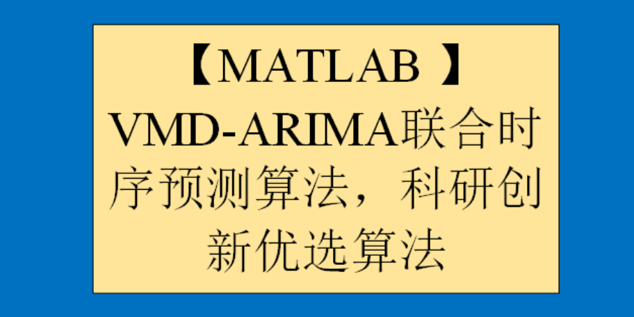

# [MATLAB] VMD-ARIMA Joint Time Series Prediction Algorithm, Scientific Research Innovation Preferred Algorithm

Intention to obtain the code, please refer to the end of the article for the method of obtaining the code~ 
1 VMD Decomposition Algorithm
VMD decomposition, also known as Variational Mode Decomposition, is an innovative signal decomposition method. It involves using variational inference methods to decompose a signal into a set of localized vibration modes, each containing multiple frequency components. The main steps of VMD are as follows:
Multiple low-pass filters are applied to the original signal to obtain multiple band signals.
Variational inference is performed on each band signal to obtain its localized vibration modes.
All localized vibration modes corresponding to the band signals are summed to obtain the VMD decomposition of the original signal. The advantages of VMD decomposition include: it automatically extracts the local features of the signal, avoiding the need for manual selection of basis functions in traditional decomposition methods; it can handle nonlinear and non-stationary signals without generating mode overlap issues. Therefore, VMD has been widely applied in signal processing, image processing, and pattern recognition fields.
MATLAB Signal Decomposition 7th Edition - VMD Decomposition:
For detailed information about signal decomposition tools, please refer to:
2 ARIMA (Autoregressive Integrated Moving Average) time series forecasting algorithm
The ARIMA (Autoregressive Integrated Moving Average) model is a predictive model based on time series analysis, suitable for analyzing and predicting data with both temporal dependence and randomness. The ARIMA model was first proposed by Box and Jenkins in 1976 and has been widely used in the fields of production and finance for data prediction. The core idea of the ARIMA model is to differentiate the time series data to make it stationary, then establish the model through the combination of autoregression (AR) and moving average (MA), and use this model for prediction. In the ARIMA model, "AR" represents autoregression, that is, the current data is related to the data from several previous moments; "I" represents differencing, that is, the data is differentiated to make it stationary; "MA" represents moving average, that is, the current data is related to the error from several previous moments. The establishment process of the ARIMA model includes three steps: model identification, parameter estimation, and model verification. In the model identification stage, it is necessary to determine the order of the ARIMA model and the number of differencing times; in the parameter estimation stage, it is necessary to estimate the parameters of the model; in the model verification stage, it is necessary to verify the model and judge whether the prediction accuracy meets the requirements. The ARIMA model has the advantage of fully utilizing the historical information of time series data for prediction, can adapt to various types of time series data, and has good explanatory power. However, there are some disadvantages to the ARIMA model, such as the need to differentiate non-stationary time series data, and the process of parameter estimation is relatively complex.
MATLAB | Time series forecasting | ARIMA forecasting model:
Details about 5 kinds of time series forecasting schemes can be found in the following:
3 VMD-ARIMA joint time series forecasting algorithm Next, we will introduce in detail the principle and thought of the latest VMD-ARIMA joint time series forecasting algorithm.
The signal decomposition can divide the original data into N layers of imf components, then this study expands the ARIMA time series prediction for each layer's imf component, and reconstructs the predicted values of the imf components to obtain the VMD-ARIMA joint time series prediction value. 
By comparing the VMD-ARIMA joint time series prediction value with the simple ARIMA time series prediction value with the true values, we can find that the VMD-ARIMA joint time series prediction algorithm has a good predictive effect. The reason is not difficult to see, signal decomposition is to divide the original data into different frequency data, which means the frequency of each layer imf component is roughly the same, it is data with good periodicity and regularity, therefore when using the ARIMA time series prediction algorithm to predict each layer imf component, its prediction effect will be closer to the true value. 
The following are some diagrams of the prediction process. 
The following is a brief video tutorial.

## Images

<!-- PAYMENT_BLOCK -->

## Get this dataset

- Payment link (Stripe): [Buy now](https://buy.stripe.com/3cs8yP7sY87d0vu9AB)
- Payment QR code: 

<!-- /PAYMENT_BLOCK -->
